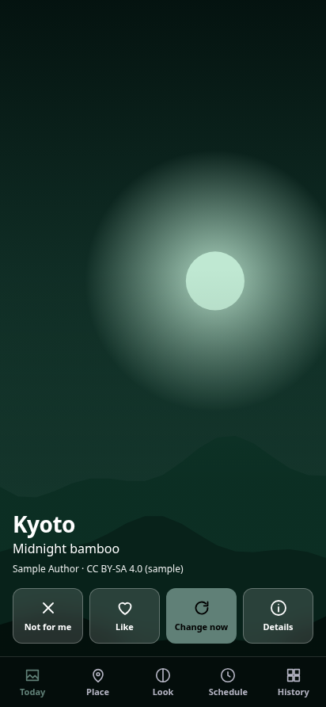
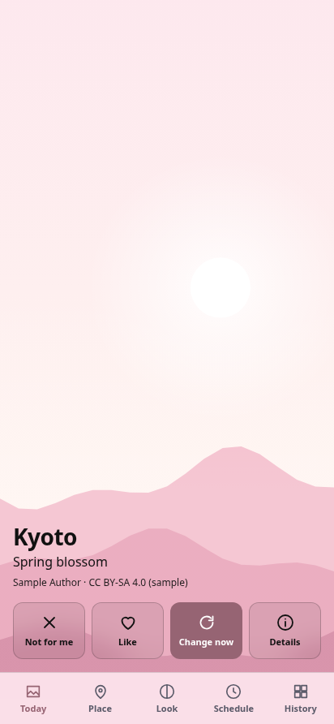
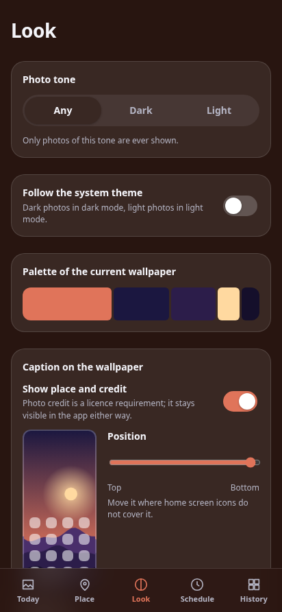

# Dynamic Themed Wallpapers

[Русская версия](README.ru.md)

An Android app that sets one beautiful photo of a place you choose as your wallpaper every day,
with a small caption saying what the place is.

<p>
  
  
  
</p>

<sub>The screenshots come from the in-memory mock backend with generated sample scenes, not real photos.</sub>

## What it does

- **Any place**: a country, a city, a district, a mountain, a temple — found via Wikidata.
- **Tone-aware**: ask for dark photos only (or light, or follow the system theme) and you will never get the other kind.
- **Picks beautiful photos, not random ones**: curated sets first (Wikimedia Commons Featured / Quality / Valued images),
  then technical filters (sharpness, clipping, resolution, crop loss), then a small on-device model that learns from
  your likes and skips. See [docs/scoring.md](docs/scoring.md).
- **A caption you can place**: the text goes where your home screen icons do not cover it (top, middle, bottom;
  left, centre, right), or can be turned off.
- **Battery-friendly**: the daily change runs in a WorkManager job that calls straight into Rust over JNI — no WebView,
  no foreground service, no polling. Photos are prefetched while on an unmetered network and charging.
- **A theme from the photo**: the app's colours come from the current wallpaper's palette, with contrast floors checked.

## Install

Download the APK from the [latest release](https://github.com/spacer-man/dynamic-themed-wallpapers/releases/latest)
and open it on your phone (Android 7.0+; you will be asked to allow installing from your browser or file manager).
The release notes list the SHA-256 checksum.

## Privacy

**No telemetry. No analytics. No accounts. No crash reporters.**

The app only talks to `commons.wikimedia.org`, `www.wikidata.org`, `query.wikidata.org` and — only if you turn it on and
supply your own key — `api.unsplash.com`. Everything it learns about your taste stays on the device.
See [docs/privacy.md](docs/privacy.md).

## Attribution

Most photos are licensed CC BY / CC BY-SA. The app always shows the author and license of the current photo — that is
a license requirement, not a courtesy. If you hide the caption on the wallpaper, the credit stays visible in the app.

## Project layout

```
crates/core   pure-Rust engine: place search, photo sources, scoring, cropping, storage
src           Svelte 5 UI
src-tauri     Tauri v2 shell, Android plugin, and the JNI entry point used by the background worker
docs          architecture, scoring, sources, privacy, design, open questions
```

## Building

**The engine** (place search, photo selection, scoring) needs only Rust:

```sh
cargo test --workspace
cargo run -p wallpaper-core --example pick -- --place "Kyoto" --tone dark --screen 1080x2400 --explain
```

The example talks to the real Wikidata/Commons APIs, prints every candidate with its measurements and verdict, and
writes the chosen photo (already cropped to the screen) into `out/`.

**The UI** in a browser with an in-memory mock backend:

```sh
bun install
bun run dev            # http://localhost:1420, sample scenes instead of real photos
bun test               # unit tests of the UI logic
bun run check          # svelte-check
```

**The desktop app** (UI + real engine): `bun run tauri dev`. On Linux this needs the
[Tauri prerequisites](https://v2.tauri.app/start/prerequisites/).

**The Android app** needs JDK 17, the Android SDK (platform 36, build-tools 36.0.0), NDK 27.2.12479018 and the Rust
Android targets (`rustup target add aarch64-linux-android`):

```sh
bun install
./node_modules/.bin/tauri android build --debug --apk --target aarch64 --features sqlite-bundled
```

A debug build is signed with the standard Android debug key. A release build is signed with your own keystore:
copy nothing into the repository, put the keystore anywhere and pass it through environment variables, see
[docs/releasing.md](docs/releasing.md).

Build notes:

- The default TLS backend is `ring` (needs a C compiler). Without one, build with
  `--no-default-features --features tls-graviola` (pure Rust).
- `wallpaper-core` links the system SQLite on desktop; Android builds must enable the `sqlite-bundled` feature.
- `.github/workflows/ci.yml` runs the same checks on every push and pull request.

## Status

Early development; tested on a real phone, but the scheduled daily change is not yet field-tested. Android only — iOS has no public API for changing the wallpaper.
Decisions that were made without the owner and could go the other way are in
[docs/OPEN-QUESTIONS.md](docs/OPEN-QUESTIONS.md).

## License

Licensed under either of

- Apache License, Version 2.0 ([LICENSE-APACHE](LICENSE-APACHE))
- MIT license ([LICENSE-MIT](LICENSE-MIT))

at your option. Unless you explicitly state otherwise, any contribution intentionally submitted for inclusion in the work
by you, as defined in the Apache-2.0 license, shall be dual licensed as above, without any additional terms or conditions.
