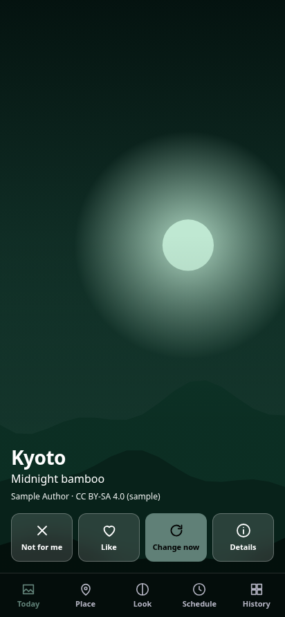
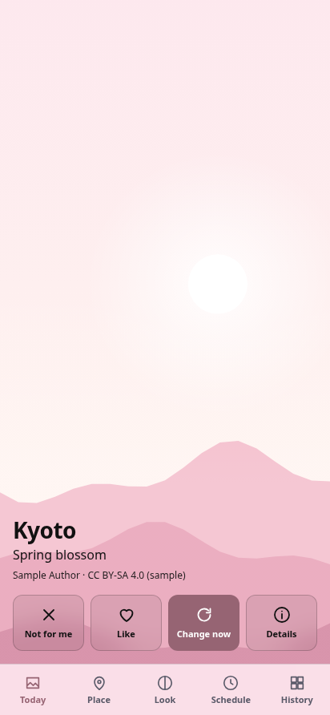
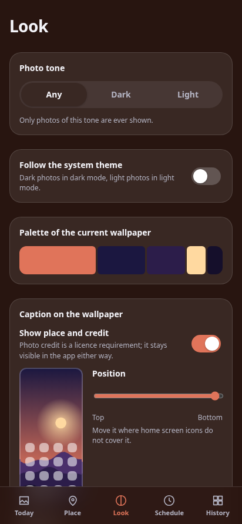

# 🖼️ Dynamic Themed Wallpapers

[English version](README.md)

[](https://github.com/spacer-man/dynamic-themed-wallpapers/actions/workflows/ci.yml)
[](https://github.com/spacer-man/dynamic-themed-wallpapers/releases/latest)
[](#license)
[](#install)
[](https://v2.tauri.app/)
[](crates/core)
[](https://svelte.dev/)


Android-приложение, которое каждый день ставит на обои одну красивую фотографию выбранного вами места
с небольшой подписью, что это за место.

<p>
  
  
  
</p>

<sub>Скриншоты сделаны на встроенном mock-бэкенде с нарисованными образцами, а не на настоящих фото.</sub>

## Что умеет

- **Любое место**: страна, город, район, гора, храм — поиск через Wikidata.
- **Места, слова или доска Pinterest**: сохраняйте несколько тем — место, свободный текст вроде «туманный лес» или публичную
  доску Pinterest (её 25 последних пинов) — и переключайтесь.
- **Источник на ваш выбор**: Викисклад (по умолчанию), Openverse, Wallhaven (без ключа) или Unsplash, Pexels, Pixabay
  (ваш бесплатный ключ); Pinterest — для досок. В настройках видно, доступен ли каждый. Если ежедневная смена не смогла
  получить фото, уведомление предложит другой источник на этот один раз. См. [docs/sources.md](docs/sources.md).
- **С учётом тона**: попросите только тёмные фото (или светлые, или по системной теме) и других не увидите.
- **Выбирает красивые фото, а не случайные**: сначала отобранные коллекции (избранные, качественные и ценные
  изображения Викисклада), затем технические фильтры (резкость, пересветы, разрешение, потери при кадрировании),
  затем небольшая модель на устройстве, которая учится на ваших лайках и пропусках. Подробности — в
  [docs/scoring.md](docs/scoring.md).
- **Подпись, которую можно переместить**: текст ставится туда, где его не закрывают ярлыки рабочего стола
  (сверху, посередине, снизу; слева, по центру, справа), или совсем отключается.
- **Бережёт батарею**: ежедневная смена идёт в задаче WorkManager, которая обращается к Rust напрямую через JNI:
  без WebView, без фонового сервиса, без опроса. Фото подгружаются заранее по безлимитной сети и во время зарядки.
- **Тема из фото**: цвета приложения берутся из палитры текущих обоев, контрастность проверяется.

## Установка

Скачайте APK из [последнего релиза](https://github.com/spacer-man/dynamic-themed-wallpapers/releases/latest) и откройте
его на телефоне (Android 7.0+; система попросит разрешить установку из браузера или файлового менеджера).
В описании релиза указана контрольная сумма SHA-256.

## Приватность

**Никакой телеметрии. Никакой аналитики. Никаких аккаунтов. Никаких отчётов о сбоях.**

Приложение обращается только к `commons.wikimedia.org`, `www.wikidata.org`, `query.wikidata.org` и — только для выбранного вами
источника (а для Unsplash, Pexels и Pixabay — ещё и с вашим ключом) — `api.openverse.org`, `wallhaven.cc`,
`api.unsplash.com`, `api.pexels.com`, `pixabay.com` или `www.pinterest.com`, а также серверы изображений, которые они укажут. Всё, что оно узнаёт о ваших вкусах, остаётся на
устройстве. Подробнее — [политика конфиденциальности](PRIVACY.md) и список адресов в [docs/privacy.md](docs/privacy.md).

## Авторство

Большинство фото распространяются по лицензиям CC BY / CC BY-SA. Приложение всегда показывает автора и лицензию
текущего фото — это требование лицензии, а не любезность. Если скрыть подпись на обоях, указание автора остаётся
видимым в приложении.

## Структура проекта

```
crates/core   движок на чистом Rust: поиск места, источники фото, оценка, кадрирование, хранилище
src           интерфейс на Svelte 5
src-tauri     оболочка Tauri v2, Android-плагин и JNI-вход для фонового воркера
docs          архитектура, оценка, источники, приватность, дизайн, открытые вопросы
```

## Сборка

**Движку** (поиск места, выбор фото, оценка) нужен только Rust:

```sh
cargo test --workspace
cargo run -p wallpaper-core --example pick -- --place "Kyoto" --tone dark --screen 1080x2400 --explain
```

Пример обращается к настоящим API Wikidata и Викисклада, печатает каждого кандидата с измерениями и вердиктом
и сохраняет выбранное фото (уже обрезанное под экран) в `out/`.

**Интерфейс** в браузере со встроенным mock-бэкендом:

```sh
bun install
bun run dev            # http://localhost:1420, образцы вместо настоящих фото
bun test               # тесты логики интерфейса
bun run check          # svelte-check
```

**Десктопное приложение** (интерфейс и настоящий движок): `bun run tauri dev`. В Linux нужны
[зависимости Tauri](https://v2.tauri.app/start/prerequisites/).

**Android-приложению** нужны JDK 17, Android SDK (платформа 36, build-tools 36.0.0), NDK 27.2.12479018 и
Android-таргеты Rust (`rustup target add aarch64-linux-android`):

```sh
bun install
./node_modules/.bin/tauri android build --debug --apk --target aarch64 --features sqlite-bundled
```

Отладочная сборка подписана стандартным debug-ключом Android. Релизную подписывают вашим собственным keystore:
в репозиторий его не кладите, храните где угодно и передавайте через переменные окружения, см.
[docs/releasing.md](docs/releasing.md).

Заметки по сборке:

- TLS по умолчанию — `ring` (нужен компилятор C). Без него собирайте с
  `--no-default-features --features tls-graviola` (чистый Rust).
- На десктопе `wallpaper-core` использует системный SQLite; для Android обязательна фича `sqlite-bundled`.
- `.github/workflows/ci.yml` выполняет те же проверки при каждом пуше и pull request.

## Статус

Ранняя разработка; проверено на настоящем телефоне, но ежедневная смена по расписанию ещё не проверена в деле. Только Android: в iOS нет публичного API
для смены обоев. Решения, принятые без владельца и допускающие другой исход, перечислены в
[docs/OPEN-QUESTIONS.md](docs/OPEN-QUESTIONS.md) (на английском).

## Лицензия

Лицензировано на ваш выбор по одной из двух:

- Apache License, Version 2.0 ([LICENSE-APACHE](LICENSE-APACHE))
- лицензия MIT ([LICENSE-MIT](LICENSE-MIT))

Если вы прямо не указали иное, любой вклад, сознательно отправленный вами для включения в проект в смысле
Apache-2.0, лицензируется так же, как выше, без дополнительных условий.
